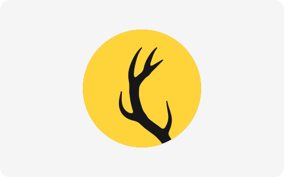
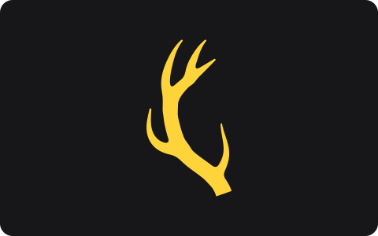
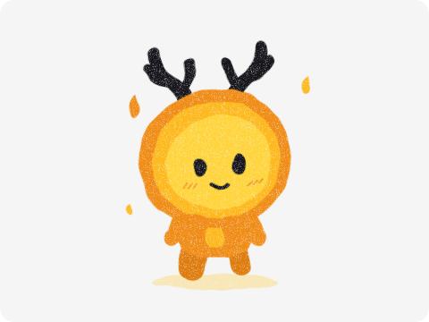
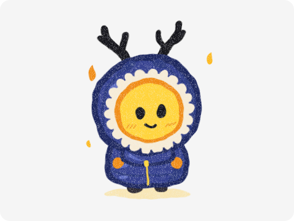

# 공모전헌터 브랜드 에셋

**[전체 파일 받기 (zip)](https://github.com/GongHunt/gonghunt-brand/releases/latest)**

## 배지

<table>
  <tr>
    <td></td>
  </tr>
  <tr>
    <td align="center"><a href="logos/badge/color/gonghunt-badge-color.svg">SVG</a> | <a href="logos/badge/color">PNG</a></td>
  </tr>
</table>

## 마크

<table>
  <tr>
    <td></td>
    <td></td>
  </tr>
  <tr>
    <td align="center"><a href="logos/mark/black/gonghunt-mark-black.svg">SVG</a> | <a href="logos/mark/black">PNG</a></td>
    <td align="center"><a href="logos/mark/yellow/gonghunt-mark-yellow.svg">SVG</a> | <a href="logos/mark/yellow">PNG</a></td>
  </tr>
</table>

## 한 색만 쓸 때

<table>
  <tr>
    <td></td>
    <td></td>
    <td></td>
  </tr>
  <tr>
    <td align="center"><a href="logos/badge/black/gonghunt-badge-black.svg">SVG</a> | <a href="logos/badge/black">PNG</a></td>
    <td align="center"><a href="logos/badge/white/gonghunt-badge-white.svg">SVG</a> | <a href="logos/badge/white">PNG</a></td>
    <td align="center"><a href="logos/mark/white/gonghunt-mark-white.svg">SVG</a> | <a href="logos/mark/white">PNG</a></td>
  </tr>
</table>

## 크기

## 웹 아이콘

## 프로필 사진

## 색

## 여백

## 쓰지 않는 예

## 마스코트 노랑이

<table>
  <tr>
    <td></td>
    <td></td>
    <td></td>
  </tr>
  <tr>
    <td align="center">기본 <a href="mascot/basic/gonghunt-mascot-basic.svg">SVG</a> | <a href="mascot/basic">PNG</a></td>
    <td align="center">우비 <a href="mascot/raincoat/gonghunt-mascot-raincoat.svg">SVG</a> | <a href="mascot/raincoat">PNG</a></td>
    <td align="center">털 후드 <a href="mascot/fur-hood/gonghunt-mascot-fur-hood.svg">SVG</a> | <a href="mascot/fur-hood">PNG</a></td>
  </tr>
</table>

밝은 바탕에 써요. 어두운 바탕에서는 검정 뿔이 묻혀요.

제스처, 움직이는 GIF, 다른 색 코스튬은 [마스코트 캔버스](https://claude.ai/artifact/HkuY4VEbqhKuBmyxhjLSSR)에서 봐요. 캔버스는 팀원만 열 수 있어요.

---

[로고 사용 안내](LICENSE.md) | [파일 고치는 법](CONTRIBUTING.md)
