# 공모전헌터 브랜드 에셋

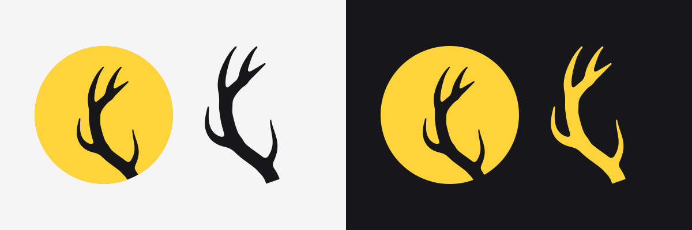

**[전체 파일 받기 (zip)](https://github.com/GongHunt/gonghunt-brand/releases/latest)**

## 배지

<table>
  <tr>
    <td><a href="logos/badge/black">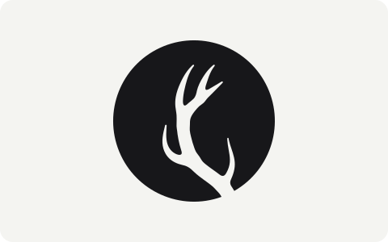</a></td>
    <td><a href="logos/badge/white">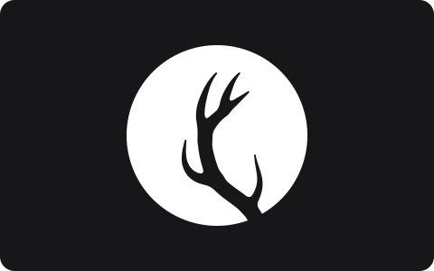</a></td>
  </tr>
  <tr>
    <td align="center"><a href="logos/badge/black/gonghunt-badge-black.svg">SVG</a> | <a href="logos/badge/black">PNG</a></td>
    <td align="center"><a href="logos/badge/white/gonghunt-badge-white.svg">SVG</a> | <a href="logos/badge/white">PNG</a></td>
  </tr>
</table>

## 마크

<table>
  <tr>
    <td><a href="logos/mark/black">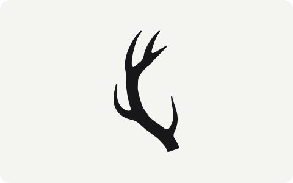</a></td>
    <td><a href="logos/mark/white">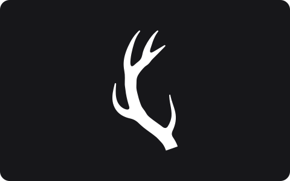</a></td>
  </tr>
  <tr>
    <td align="center"><a href="logos/mark/black/gonghunt-mark-black.svg">SVG</a> | <a href="logos/mark/black">PNG</a></td>
    <td align="center"><a href="logos/mark/white/gonghunt-mark-white.svg">SVG</a> | <a href="logos/mark/white">PNG</a></td>
  </tr>
</table>

## 크기

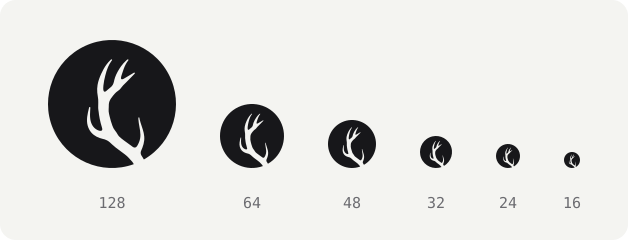

## 웹 아이콘

[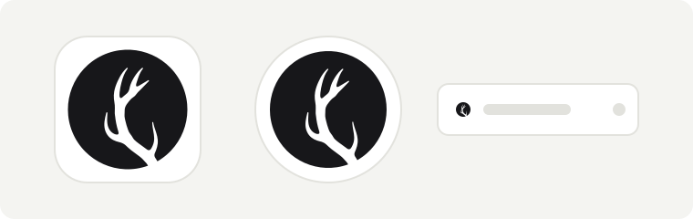](web)

## 프로필 사진

[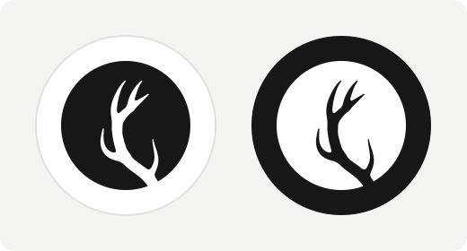](social)

## 색

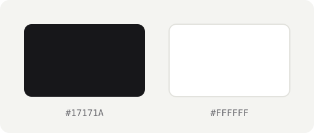

## 여백

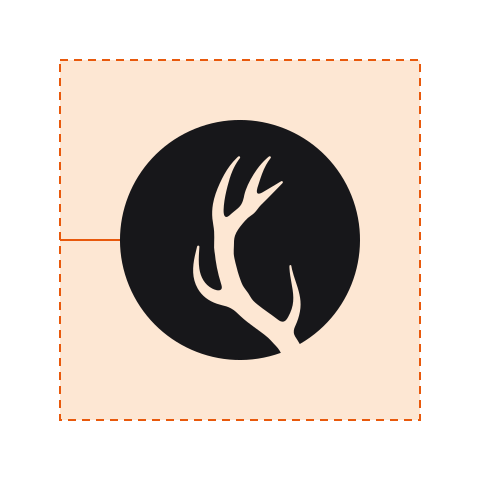

## 이렇게 쓰지 않습니다

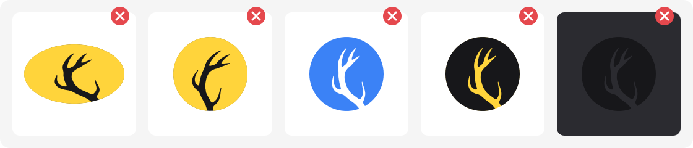

---

[로고 사용 안내](LICENSE.md) | [파일 고치는 법](CONTRIBUTING.md)
